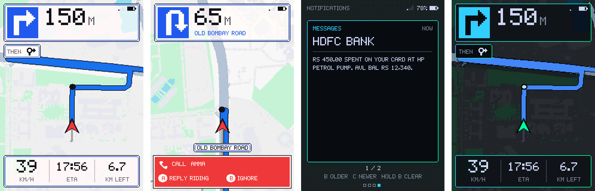
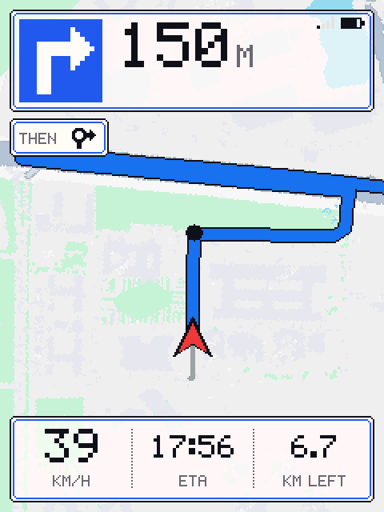
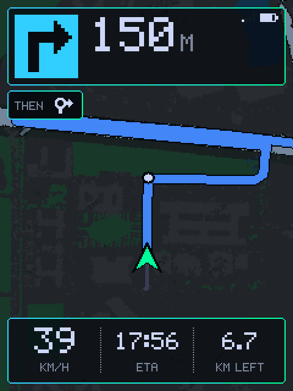
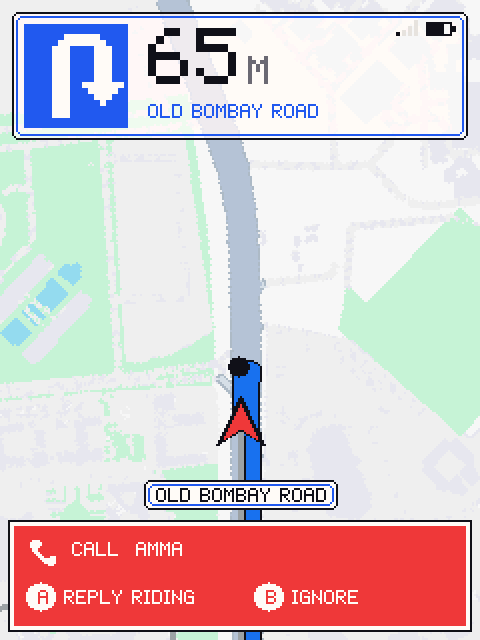
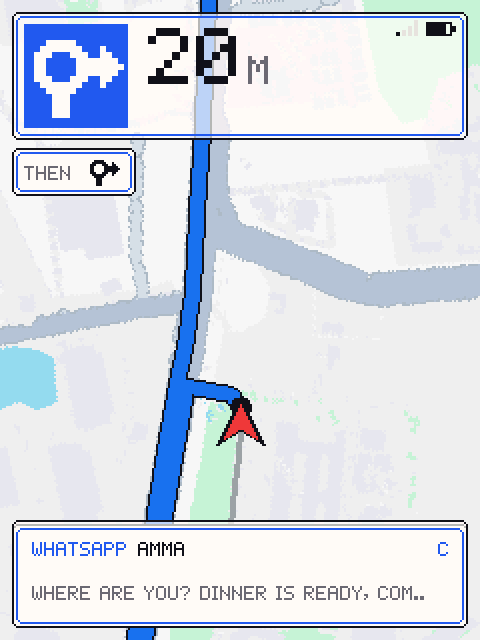
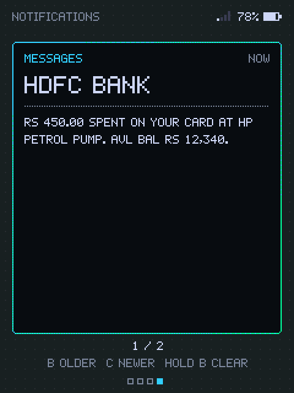
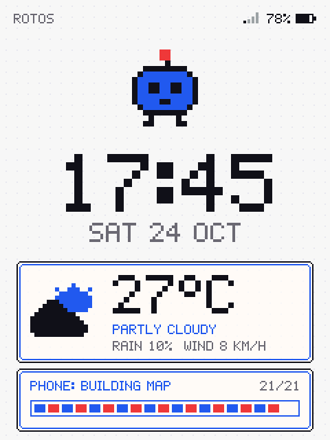
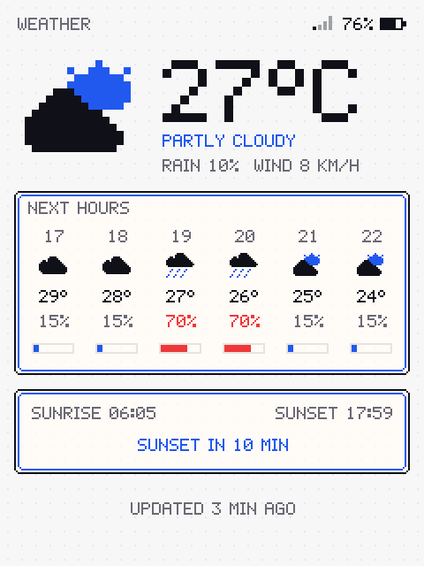
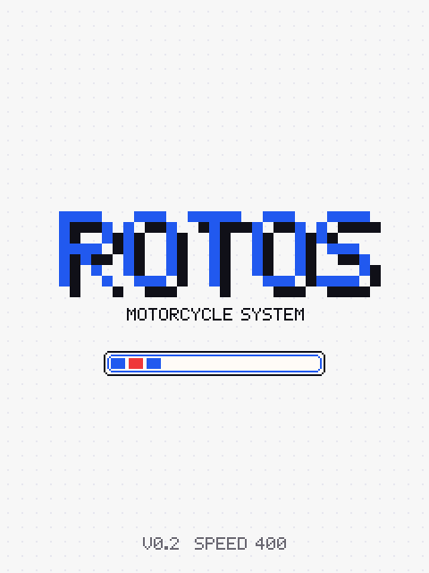

# ROTOS

**A pixel-art navigation display for motorcycles, driven by your phone and Google Maps.**

ROTOS is a small handlebar screen (an ESP32 and a 2.8" TFT) that shows the map,
your position, Google Maps' blue route line and every turn, plus calls,
messages, weather and the time. The phone does all the work: Google Maps
navigates, the ROTOS app turns Google's route and map into a compact "map pack"
and streams it over Bluetooth Low Energy. The device only draws, in a
16-colour, early-Nintendo style that stays readable in sunlight.



> Built for a Triumph Speed 400, but nothing is bike-specific: ROTOS only takes
> 5 V USB power and never connects to the motorcycle's wiring, ECU or CAN bus.

---

## Features

- **Google Maps navigation on the handlebar**: share a place from Google Maps
  to ROTOS and you get Google's two-wheeler route as a blue line on a map
  built from Google's tiles, with Google's turn-by-turn, distance left and ETA.
- **Works with plain Google Maps navigation too**: start navigating in Google
  Maps and ROTOS shows the map around you and every turn (no line, because
  Google Maps does not tell other apps the destination).
- **Follows Google's reroutes**: when Google Maps takes another road, ROTOS
  fetches the new route and swaps the line; leaving the mapped area builds a new
  map around you. The old map stays on screen while the new one loads.
- **Survives restarts**: if the app is updated or killed mid-ride, the shared
  route comes back by itself.
- **Fast uploads**: map packs are deflate-compressed on the link and inflated on
  the device straight into a pre-erased flash slot (a typical route map arrives
  in ~2-5 s).
- **Calls**: the caller's name in a bright bar at the bottom of the screen.
  **A** rejects the call and texts *"I'm riding right now, I'll call you back
  later (around 18:30)"*; **B** ignores it and silences the ringtone.
- **Notifications**: new messages pop up at the bottom for a few seconds; a
  notifications page keeps the last eight, browsable with the buttons.
- **Dashboard and weather**: clock, date, phone battery and signal, current
  weather and an 8-hour forecast with sunrise and sunset.
- **Day and night themes** in Google Maps' own colours, switching automatically
  at sunset.
- **Google usage guard rails**: every billed Google call goes through one gate
  with daily and monthly caps at about half of Google's free tier, so a bug can
  never run up a bill.

## Screenshots

| Map (day) | Map (night) | Incoming call | New message |
|---|---|---|---|
|  |  |  |  |

| Notifications page | Dashboard | Weather | Boot |
|---|---|---|---|
|  |  |  |  |

*Screens rendered by the desktop simulator, which runs the exact firmware code,
on the bundled sample ride.*

## How it works

```
 Google Maps (navigates)            ROTOS Android app                     ROTOS device
 ───────────────────────            ─────────────────                     ────────────
 turn-by-turn notification ──────►  mirror: turns, distance, ETA  ─┐
 Share → ROTOS (destination) ────►  Google Routes API (route)       │  BLE   ESP32 + 2.8" TFT
                                    Google Map Tiles API (map)      ├──────► map pack in flash
                                    core C library (JNI):           │        30 fps map, HUD,
                                      map matching, map pack,       │        calls, notifications,
                                      deflate for the link          │        weather, dashboard
 calls, messages, battery ───────►  call + notification forwarding ─┘ ◄──── buttons A / B / C
```

One portable C library (`core/`) does all the navigation maths. It runs on the
phone through JNI, in the desktop simulator, and the parts the device needs are
compiled into the firmware, so every side computes the same answers.

## Hardware

About ₹1,500 / US$20 of parts, no custom PCB.

| Part | Notes |
|---|---|
| ESP32 DevKit V1 (ESP32-WROOM-32, 4 MB flash) | ESP32-C3 and ESP32-S3 boards also build (`firmware/main/board.h`) |
| 2.8" SPI TFT, ILI9341, 240×320, no touch | backlight on 3V3 |
| 3 tactile push buttons | A, B, C |
| USB-C to micro-B cable | powered from the bike's USB-C port |
| Perfboard, wire, an enclosure and a handlebar mount | enclosure designs go in `cad/` |

Wiring for the DevKit V1:

| TFT / part | ESP32 pin |
|---|---|
| VCC / GND | VIN (5 V) / GND |
| SCK / SDI (MOSI) / CS | GPIO 18 / 23 / 5 |
| DC / RESET | GPIO 16 / 17 |
| LED (backlight) | 3V3 |
| Buttons A / B / C | GPIO 32 / 33 / 25, each to GND (internal pull-ups) |

Full parts list, power notes and a bring-up checklist: [docs/HARDWARE.md](docs/HARDWARE.md).

## Getting started

### Requirements

- Linux or macOS with **Docker** (firmware and Android builds run in containers)
- For the host build and simulator: CMake ≥ 3.16, a C compiler, SDL2, Python 3, zlib
- An Android phone (tested on Android 15) and a Google Cloud project

### 1. Build and test everything on the desktop

```sh
git clone <this repository> rotos && cd rotos
make test        # C unit tests, coding-standard check, Android unit tests
make sim         # simulated ride on the screen twin
make help        # every target
```

### 2. Google Maps Platform key

ROTOS uses three Google APIs: **Routes API**, **Map Tiles API** and **Maps SDK
for Android**.

1. In the Google Cloud console, enable those three APIs for your project.
2. Create an API key. Under *Application restrictions* choose **Android apps**
   and add the package `dev.rotos.app` with the SHA-1 fingerprint of your
   release signing key (`make release` creates the key and prints how to read
   the fingerprint, see [android/README.md](android/README.md)).
3. Under *API restrictions* allow only the three APIs above.
4. Put the key in `android/local.properties` (gitignored, never commit it):

   ```properties
   MAPS_API_KEY=your-key-here
   ```

Without a key the app still mirrors Google Maps' turns, but builds no maps.

### 3. Firmware

```sh
make firmware                        # ESP32 DevKit V1 (ESP-IDF 5.3 in Docker)
make flash                           # flash over USB and open the serial monitor
firmware/scripts/hwtest.sh           # optional: screen, orientation and button test
```

### 4. Android app

```sh
make release                         # signed release APK in android/out/
make install-phone                   # install over USB (adb in Docker)
```

Open the app, grant the permissions it asks for (location, Bluetooth, phone,
SMS, contacts) and **notification access** (needed to read Google Maps' turns
and your notifications), then switch on **Connect to ROTOS**.

## Riding with ROTOS

1. Power ROTOS from the bike and switch on **Connect to ROTOS** in the app.
2. In Google Maps, tap your destination, then **Share → ROTOS**. ROTOS builds
   the map with Google's route and starts Google Maps navigation for you.
3. Ride. ROTOS shows the map, the blue line, the next turn, speed and ETA.

| Button | Normally | Incoming call | Notifications page |
|---|---|---|---|
| **A** | next page: map → dashboard → weather → notifications | reject + "riding" SMS | next page |
| **B** | theme: auto → day → night (hold: glass level) | ignore + silence ringtone | older (hold: clear all) |
| **C** | open a new-message banner | | newer |

While moving, ROTOS returns to the map by itself after a few seconds on another
page.

## Google usage and cost

Every billed call (Routes, Map Tiles, tile sessions) passes through
`quota/UsageGuard` in the app, which caps usage at about half of Google's
monthly free tier:

| API | Daily cap | Monthly cap | Also |
|---|---|---|---|
| Routes | 200 | 2,500 | at most one automatic reroute per 30 s |
| Map tiles | 8,000 | 50,000 | each tile downloaded once and cached |
| Tile sessions | 20 | 200 | a session is reused for ~2 weeks |

The app shows today's and this month's counts on its *Google usage* card, and
ROTOS shows **G!** next to the battery when usage is close to a cap. At a cap
ROTOS keeps showing Google Maps' turns but builds no new maps until the cap resets.

## Repository layout

```
firmware/        ESP32 firmware (C11, ESP-IDF 5.3): main/, hal/ (hardware layer),
                 app/ (portable logic, also run by the simulator), hwtest/, scripts/
android/         Android app (Kotlin + JNI), packages by task: ride/, quota/, route/,
                 map/, mirror/, notify/, call/, link/, nav/, phone/, location/, share/
ui/              everything drawn: firmware/ (ROTOS screens in C) and
                 android/ (app screens and resources)
core/            navigation library shared by phone, simulator and device
                 (C11): base/ geo/ route/ map/ link/ ffi/, tests/, python/
sim/             screen digital twin (SDL2), desktop runner, virtual phone (Python)
cad/             enclosure designs
docs/            architecture, hardware, protocol, simulator, coding standard
tools/           nasa_check.py: coding-standard checks + cppcheck
```

## Simulator

`make sim` replays a full simulated ride through the real firmware code on a
desktop "digital twin" of the ILI9341 screen: map transfer, navigation, a call,
notifications and the ride summary. `sim/run.sh --live` lets the Android
emulator (or the Python virtual phone) talk to the simulated device over TCP.
The virtual phone works offline with a bundled sample route. See
[docs/SIMULATOR.md](docs/SIMULATOR.md).

## Development

- **C code** (core, firmware) follows a NASA/JPL "Power of Ten" style: no
  dynamic memory after start-up, bounded loops, assertions, short functions,
  warnings as errors. `make nasa` checks it.
- **Kotlin** keeps decisions (reroute rules, usage caps, filters, parsing) in
  pure functions with JVM unit tests; Android APIs stay at the edges.
- Docs: [Architecture](docs/ARCHITECTURE.md) · [Protocol](docs/PROTOCOL.md) ·
  [Firmware](docs/FIRMWARE.md) · [Simulator](docs/SIMULATOR.md) ·
  [Coding standard](docs/CODING_STANDARD.md) · [Ideas](docs/IDEAS.md)

Contributions are welcome: open an issue to discuss bigger changes, keep
`make test` green, and match the coding standard.

## Privacy

- Your location, route, calls and messages stay between your phone and ROTOS
  (Bluetooth). Nothing is uploaded anywhere except the requests the features
  need: Google's Routes and Map Tiles APIs (positions and destination) and
  Open-Meteo (your approximate position, for weather).
- Notifications and caller names are sent to the device only, and only while
  the matching switches are on. The app's log records app names, never
  message text.
- Your API key and signing key live in gitignored files on your machine.

## Safety

ROTOS is a hobby project, not a certified navigation device. Glance, don't
read; set it up before you ride; obey local laws on mounting displays and using
phones while riding. It never connects to the motorcycle's electrical system
beyond USB power.

## License

[MIT](LICENSE).

Map data and routes © Google. Weather by [Open-Meteo](https://open-meteo.com).
Colour themes inspired by [Catppuccin](https://catppuccin.com). The deflate
decoder follows Mark Adler's *puff*. Built with ESP-IDF and NimBLE.
